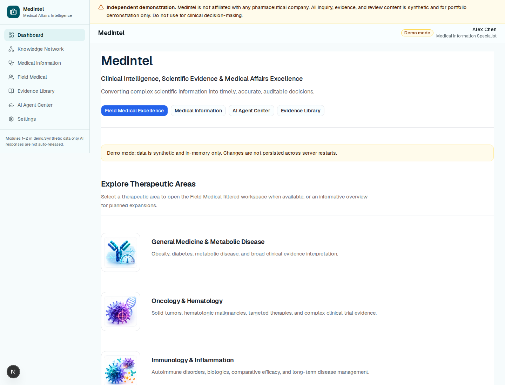
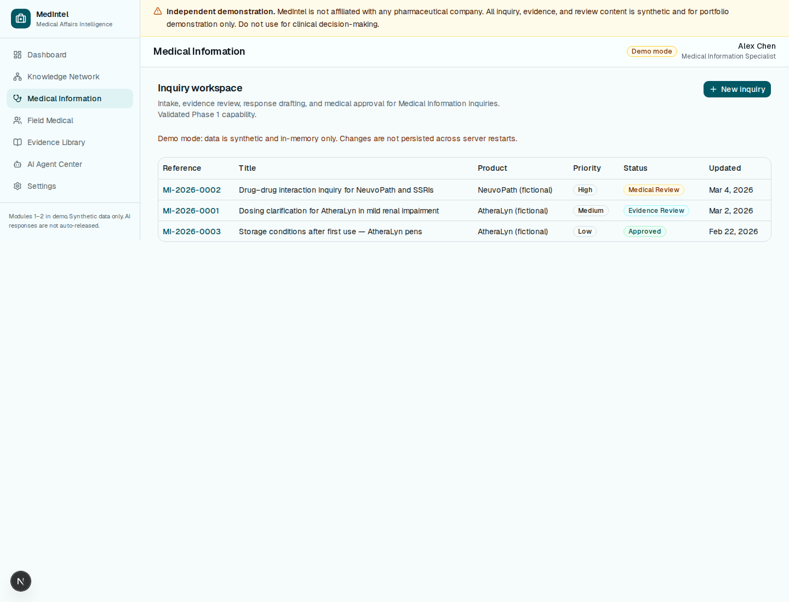
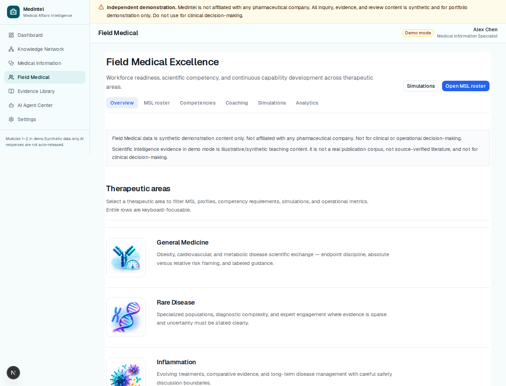
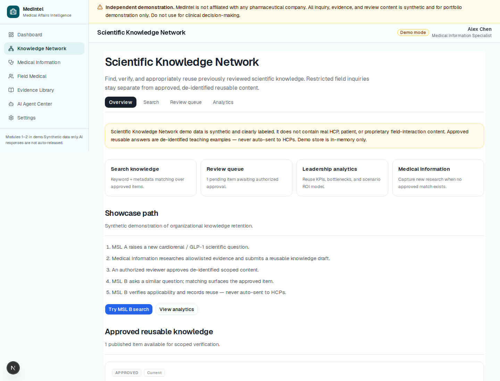
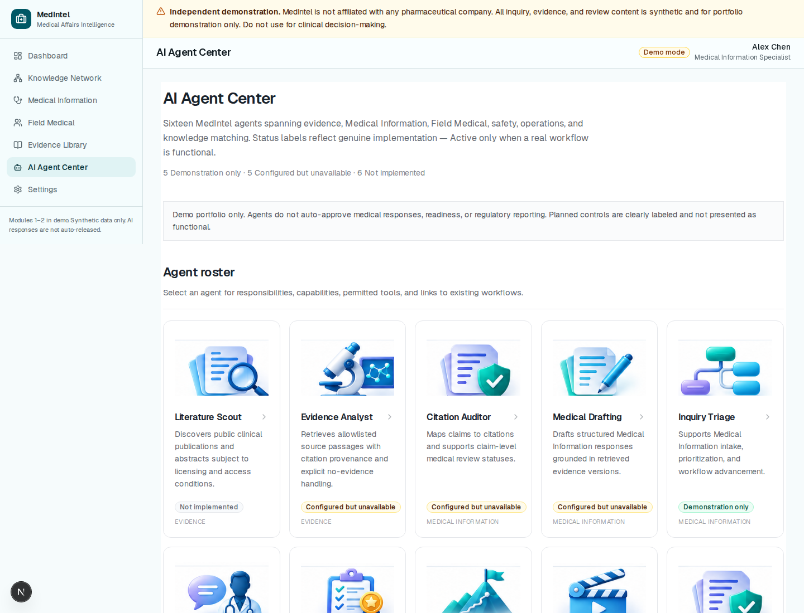
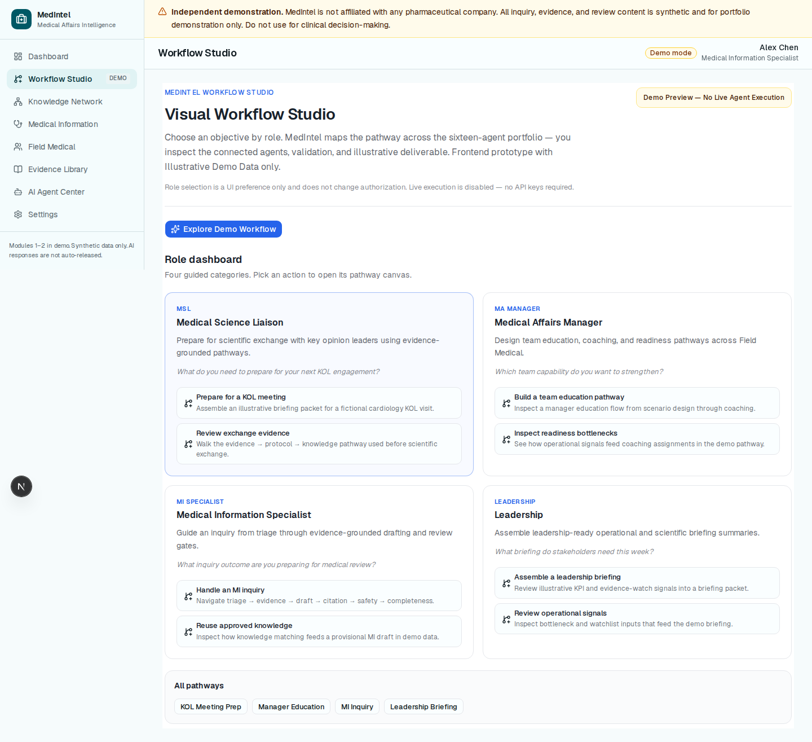
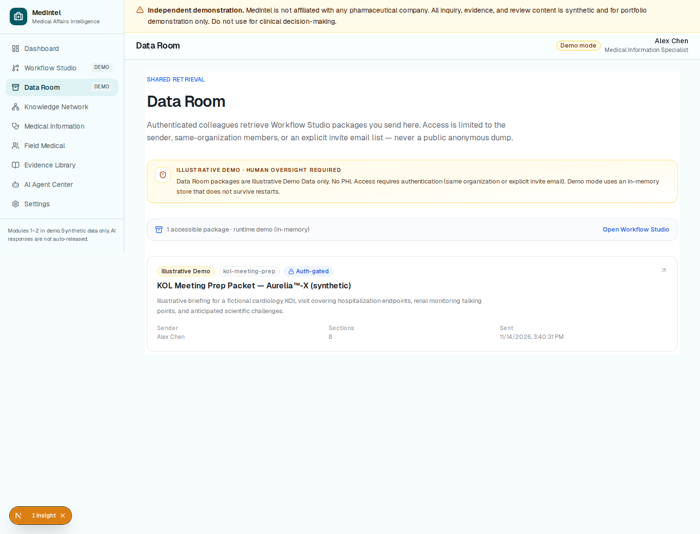

# MedIntel Capstone Showcase

Independent demonstration portfolio for pharmaceutical **Medical Affairs** and **Clinical Intelligence** workflows.

> **Not affiliated with any pharmaceutical company. All data is synthetic / illustrative. Not for clinical decision-making. AI responses are never auto-released.**

This document is the repository companion to the Project store materials under `media/capstone/` (HTML storyboard, screenshots, PowerPoint).

---

## Portfolio thesis

MedIntel shows how Medical Affairs teams can move from fragmented scientific questions to **governed, auditable** outcomes:

1. **Medical Information** owns inquiry lifecycle and medical approval.
2. **Field Medical** develops MSL readiness with coaching and simulations (never auto-certifying competency).
3. **Knowledge Network** retains approved answers so the next MSL does not restart from zero.
4. **AI Agent Center** makes agent intent and maturity **honest** (demo / unavailable / not implemented).
5. **Workflow Studio** (demo preview) visualizes role pathways across the agent portfolio.
6. **Data Room** (demo preview) shares packages only to authenticated colleagues — never a public dump.

---

## Architecture

```text
Governance shell (demo banner · Demo mode · RBAC · audit · human review)
  ├── Medical Information     /medical-information
  ├── Field Medical           /field-medical
  ├── Knowledge Network       /knowledge
  ├── Evidence Library        /evidence
  ├── AI Agent Center         /agents
  ├── Workflow Studio *       /workflow-studio   (demo preview)
  └── Data Room *             /data-room         (demo preview)
```

\* Workflow Studio and Data Room screenshots come from demo-preview feature work. They are labeled **DEMO** in-product and do not execute live paid AI.

### Stack (product truth)

- Next.js App Router, React, TypeScript, Tailwind CSS, shadcn/ui
- Supabase PostgreSQL + Auth (optional); demo mode without env vars
- Zod + workflow transition guards; Vitest + Playwright
- No Express / Prisma / Inngest in V1

### Workflow (MI)

`draft` → `submitted` → `evidence_review` → `response_drafted` → `medical_review` → `approved` → `closed`

Also: `rejected`, `needs_revision`. **Only `medical_reviewer` or `admin` may approve.**

---

## Modules & screenshots

Screenshots live in [`docs/capstone/screenshots/`](./capstone/screenshots/).

| Module | What it demonstrates | Key screenshot(s) |
| --- | --- | --- |
| **Dashboard** | Brand shell, module entry, therapeutic areas | `dashboard.png` |
| **Medical Information** | Inquiry list + detail; fictional products; medical review states | `medical-information.png`, `mi-inquiry-detail.png` |
| **Field Medical** | MSL / coaching / simulation / analytics corpus | `field-medical.png`, `field-medical-analytics.png` |
| **Knowledge Network** | Search · review · reuse showcase path | `knowledge-network.png` |
| **Evidence Library** | Illustrative metadata (untrusted until review) | `evidence-library.png` |
| **AI Agent Center** | 16-agent registry with status integrity | `agent-center.png` |
| **Workflow Studio** | Role dashboard, canvas, KOL deliverable | `workflow-studio-*.png`, `kol-*.png` |
| **Data Room** | Auth-gated package list/detail | `data-room-*.png`, `send-to-data-room.png` |















---

## Value by persona

### MSL

- Evidence-grounded KOL prep pathways (illustrative Workflow Studio packet)
- Simulation practice without auto-promoting to formal readiness
- Reuse of approved, de-identified knowledge with verification notes

### Medical Information specialist

- Structured inquiry states with evidence passages
- Knowledge matching into provisional drafts
- Medical-reviewer gate before anything is “approved”

### Leadership / MA manager

- Field Medical analytics and bottleneck-oriented signals
- Knowledge analytics with **explicitly labeled scenario ROI** (not validated cash savings)
- Leadership briefing pathway (illustrative) for operational summaries

---

## Agent portfolio (status integrity)

From `src/domain/agents/registry.ts` — Active only when a real demo workflow is functional:

| Status (registry) | UI framing | Examples |
| --- | --- | --- |
| `active` | Demonstration only | Inquiry Triage, KOL Simulator, Coaching Advisor, Bottleneck Analyst |
| `in_development` | Configured but unavailable | Evidence Analyst, Citation Auditor, Medical Drafting, … |
| `planned` | Not implemented | Literature Scout, Scenario Builder, Evidence Watch, … |

Live OpenAI literature / generative HCP is **not wired**. Demo uses deterministic allowlisted heuristics.

---

## Governance & demo disclaimers

1. Independent demonstration — no pharma affiliation.
2. Synthetic / illustrative data only (including Aurelia™-X / NeuvoPath / AtheraLyn teaching products).
3. Not for clinical decision-making.
4. No fabricated **real** citations — seed references are fictional teaching placeholders.
5. Human medical/scientific oversight required for any draft or agent-shaped output.
6. No PHI in the portfolio corpus.
7. Demo mode is process-memory; resets on restart; not multi-visitor isolated.
8. Do not claim enterprise production readiness; durable adapters, full tenant RLS, and live AI budgets remain incomplete (see `docs/DEMO_READINESS.md`).

---

## Deliverables

| Artifact | Location |
| --- | --- |
| This narrative | `docs/CAPSTONE.md` |
| Screenshot set | `docs/capstone/screenshots/` |
| PowerPoint | `docs/capstone/MedIntel-Capstone-Showcase.pptx` |
| HTML storyboard | `docs/capstone/medintel-capstone-storyboard.html` |

Project store mirrors (user-facing):

- `/cursor/stores/bc-1eececec-4351-4a19-9a95-d4de93fb0993/docs/medintel-capstone-showcase.md`
- `/cursor/stores/bc-1eececec-4351-4a19-9a95-d4de93fb0993/media/capstone/`
